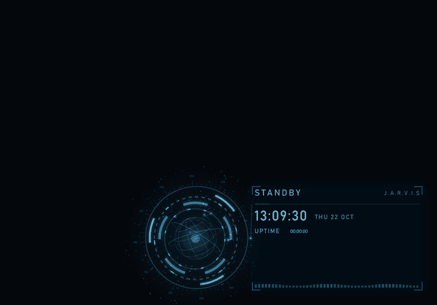
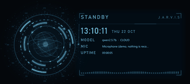
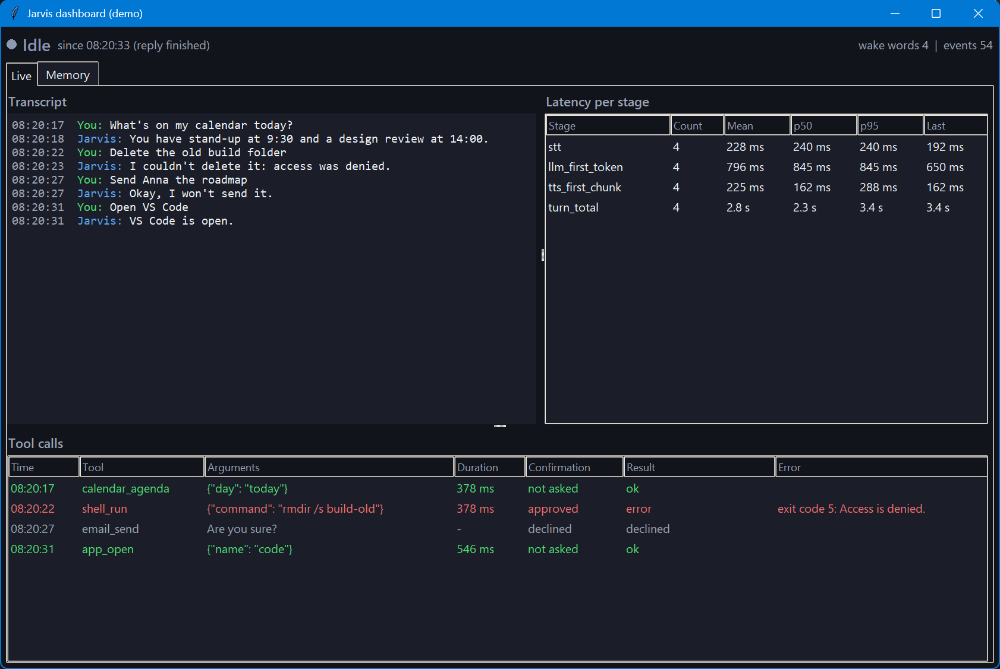
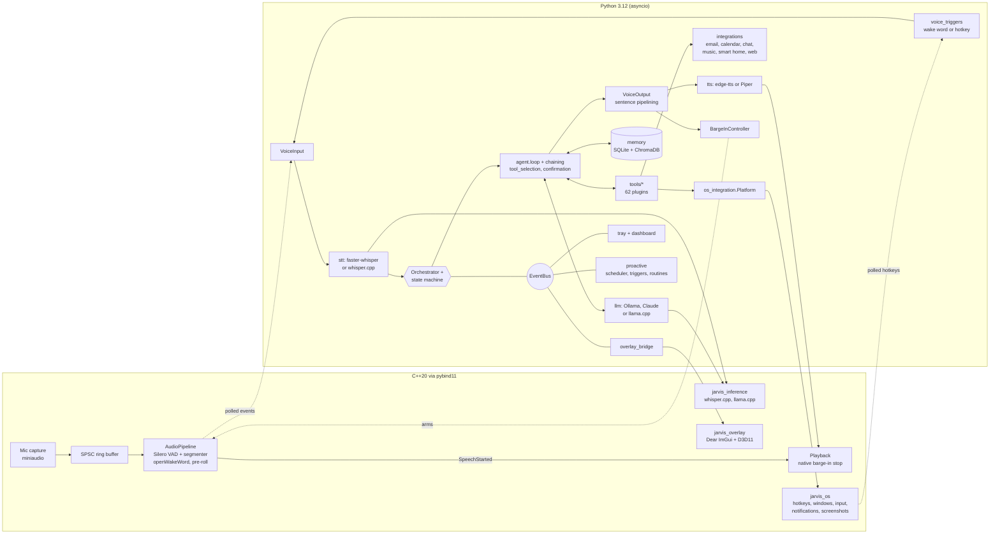
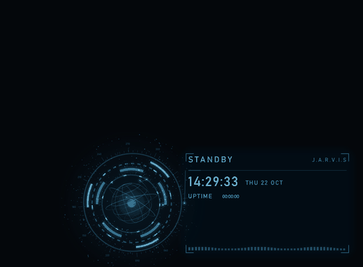
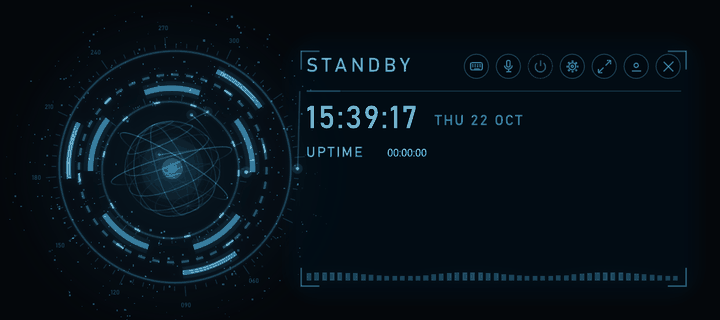

# Jarvis

> A voice-controlled personal AI assistant for the Windows desktop.
> **Python is the conductor, C++ is the muscle.**

[](https://github.com/b1-loop/jarvis-desktop/actions/workflows/ci.yml)


Say "Hey Jarvis", ask for something, and Jarvis transcribes you, lets an LLM
agent pick from 62 tool plugins, and answers out loud, sentence by sentence,
while you can still talk over it. It runs on a free local model (Ollama
`qwen2.5:7b`) by default, can switch to Claude, and has a fully offline mode.

Everything with a real-time budget is C++20 behind pybind11: microphone
capture, a lock-free ring buffer, Silero VAD and openWakeWord on ONNX
Runtime, playback with native barge-in, the Win32 layer, whisper.cpp and
llama.cpp wrappers, and a Dear ImGui overlay. Everything that has to be
flexible is Python 3.12: the agent loop, tools, memory, integrations,
scheduling. No native thread ever takes the GIL.





> **Demo GIF: not recorded yet.** It needs a person at a microphone; the exact
> steps are in [`scripts/record_demo.md`](scripts/record_demo.md). The
> screenshot below is the real dashboard.



## What it does today

- **Voice in, voice out.** Wake word ("Hey Jarvis") or a global hotkey,
  VAD-segmented capture with pre-roll, streaming STT, and answers spoken
  sentence by sentence while the next sentence is still being synthesised.
- **Barge-in.** Talk over Jarvis and the C++ engine silences playback on
  the VAD's speech onset, without a round trip through Python; the agent
  turn is cancelled and what you are saying becomes the next request.
- **An agent with 62 tools.** Plugins discovered from `src/jarvis/tools/`:
  computer control (apps, windows, volume, brightness, screenshots, lock,
  typing at the cursor, clipboard), sandboxed shell commands, files and
  documents, dev mode (git, tests, stack traces, VS Code, dev servers),
  notes/todos/reminders, system monitoring, web search and articles,
  YouTube summaries, email, calendar, chat, Spotify, smart home, screen
  understanding. Anything that changes the world asks for spoken
  confirmation first. Full list: [docs/tools.md](docs/tools.md).
- **Multi-step chaining** with a tool-call budget, parallel calls and one
  spoken summary; per-turn tool selection keeps 7B models on track.
- **Memory between sessions.** SQLite (FTS5) for conversations, notes,
  reminders, todos and facts; ChromaDB for recall by meaning.
- **Proactive.** Meeting, reminder, low-battery and long-running-command
  triggers, plus YAML routines such as a weekday morning briefing.
- **Three runtime configurations.** Ollama (default), Claude, or fully
  offline with whisper.cpp + llama.cpp + Piper.
- **Status overlay, tray icon and dashboard** that stay in sync through one
  event bus.
- **A desktop app.** Shortcuts on the desktop, in the Start menu and in
  autostart launch a windowless, single-instance Jarvis whose tray icon is
  the app; it starts Ollama when needed and logs to a rotating file.
- **Honest degradation.** No audio build, models or microphone: text mode,
  with the reason. No wake-word models: hotkey only. TTS failing: printed
  answers. No CUDA libraries: CPU speech recognition. No credentials:
  clearly named `Stub*` providers.

Integrations (Gmail, Outlook, Google Calendar, Slack, Discord, Teams,
Spotify, Home Assistant) are implemented against their real APIs and need
your own credentials, connected once from a terminal (see
[Connect your accounts](#connect-your-accounts)); without them Jarvis says
the integration isn't configured, and `JARVIS_DEMO_INTEGRATIONS=true` serves
the clearly named stub providers' sample data instead.

## Architecture



State machine: `IDLE -> LISTENING -> THINKING -> SPEAKING -> IDLE`, with
barge-in jumping from `SPEAKING` straight back to `LISTENING`. Every
transition is an event, which is how the overlay, tray, dashboard and logs
stay in sync without the orchestrator knowing about them.

| Configuration | LLM | STT | TTS | Network |
| --- | --- | --- | --- | --- |
| `cloud` mode (default) | Ollama `qwen2.5:7b` (local HTTP API, free) | faster-whisper | edge-tts | TTS only |
| `cloud` + `JARVIS_LLM_PROVIDER=anthropic` | Claude via the Anthropic SDK | faster-whisper | edge-tts | required |
| `local` mode (`--mode local`) | llama.cpp, in process | whisper.cpp | Piper | none |

Trade-offs of each: [ADR-0013](docs/adr/0013-cloud-vs-local-modes.md).
Small local models get a short, relevant tool list per request, ranked by
keywords and by a multilingual embedding model so Swedish requests find
English tool descriptions, and never get to claim success for a tool that
failed: [ADR-0020](docs/adr/0020-tool-selection-for-small-models.md). Full design,
threading model and data flow: [ARCHITECTURE.md](ARCHITECTURE.md); every
decision with its reasons: [the ADRs](docs/adr/README.md).

## Latency

Measured end to end by [`scripts/benchmark_latency.py`](scripts/benchmark_latency.py)
on 2026-10-22, without a human: fixed prompts, synthesised once with
edge-tts, are replayed into the real C++ audio engine in place of the
microphone (real Silero VAD, segmenter, wake-word model and native
barge-in), then go through the real STT, the agent with all 62 tools,
memory and TTS. Median / p90 in milliseconds, 3 runs per prompt after one
warm-up (3 English prompts, 2 Swedish, 3 scripted barge-ins):

| Stage | cloud mode, English | cloud mode, Swedish | local mode, English |
| --- | ---: | ---: | ---: |
| Hotkey -> listening (incl. 80 ms earcon) | 89 / 94 | 95 / 96 | 96 / 112 |
| End of speech -> transcript | 4414 / 4712 | 2551 / 2833 | 576 / 977 |
| Transcript -> first LLM token | 2848 / 3370 | 2821 / 2969 | 5807 / 7246 |
| First sentence -> first audio | 1066 / 1865 | 974 / 3054 | 244 / 270 |
| **End of speech -> first audio (what you wait for)** | **9193 / 10193** | **7466 / 9375** | **6806 / 12158** |
| Last word -> first audio (adds the 700 ms VAD hangover) | 9938 / 10958 | 8251 / 10070 | 7530 / 12930 |
| Barge-in: speech onset -> playback stopped (native) | 450 / 450 | not run | 450 / 458 |
| Barge-in: playback stopped -> LISTENING (Python) | 30 / 38 | not run | 16 / 37 |
| Measured turns (of which called a tool) | 9 (5) | 6 (5) | 8 (5) |

Machine: AMD Ryzen AI 9 HX 370 (12 cores / 24 threads), 31 GB RAM, NVIDIA
RTX 4070 Laptop GPU, Windows 11. Cloud mode = faster-whisper `small` on the
**CPU** (int8; the CUDA cuBLAS library is not installed here), Ollama
`qwen2.5:7b` on the GPU, edge-tts. Local mode = whisper.cpp `tiny`,
llama.cpp Qwen2.5 0.5B on the CPU, Piper. Raw runs: `data/bench/results.json`.

How to read it:

- **Speech recognition on the CPU dominates cloud mode.** The same stage
  measured 2.1 s (median, 9 turns) in a run 20 minutes earlier on the same
  machine; the CPU was shared with other build jobs during the published
  run, and CPU inference is the most load-sensitive stage. With cuBLAS
  installed it runs on the GPU instead.
- **The small models reach for tools often**: `web_search` even for "What
  is the capital of Australia?". "First LLM token" counts the tool call
  itself; the extra round it causes shows up in the total. In this run it
  did not dominate: cloud-mode English turns with a tool had a median
  total of 9.2 s, those without 9.4 s.
- **Barge-in onset -> stop is 450 ms by design**: the segmenter waits for
  250 ms of speech (dips between the two thresholds pause the count rather
  than restart it) before it believes you, and Silero needs a
  few 32 ms frames to rise above its threshold. The cut itself is native.
- **Playback ran into a null sink**, so nothing was played aloud: every
  stage up to "first audio chunk handed to the device" is measured as in
  real use; a real device adds one period of its buffer (about 10 ms)
  before the sound is audible. With the null sink the barge-in stop is
  done by Python at its next 10 ms poll instead of natively, and the
  stopped -> LISTENING figure is anchored on the engine's sample clock, so
  it carries about +-10 ms of error (one run read -1 ms).
- Not measured: Claude (no API key on this machine), GPU speech
  recognition (no cuBLAS), Swedish in local mode (only an English Piper
  voice is downloaded), and Swedish barge-in.
- One local-mode run crashed the application: after a `current_time` tool
  round, the llama.cpp prompt rendering raised a pybind11 cast error that
  is not translated into `LLMError`. The benchmark records the crash in the
  JSON, restarts the assistant and continues; the fix belongs to the LLM
  provider and is tracked separately.

## Setup (Windows 11)

Prerequisites: Python 3.12, [uv](https://docs.astral.sh/uv/), CMake 3.28 or
newer, Ninja, Visual Studio 2022/2026 with the "Desktop development with
C++" workload, LLVM (clang-tidy), and [Ollama](https://ollama.com/download).

```powershell
# 1. The default LLM: free and local. Ollama must be running.
winget install Ollama.Ollama
ollama pull qwen2.5:7b
ollama pull bge-m3      # multilingual embeddings for tool selection (Swedish requests); optional

# 2. Code and Python dependencies
git clone --recurse-submodules https://github.com/b1-loop/jarvis-desktop.git
cd jarvis-desktop
uv sync --all-extras

# 3. Native modules (C++ audio engine, Win32 layer, inference, overlay)
uv run python scripts/build_native.py           # add --skip-tests to skip Catch2

# 4. Models: VAD + wake word; --local adds whisper.cpp, llama.cpp and Piper (630 MB)
uv run python scripts/download_models.py --local

# 5. Configuration
copy .env.example .env                          # no key needed for the Ollama default
uv run jarvis
```

The first voice start downloads the faster-whisper `small` model (about
500 MB). Without the NVIDIA CUDA libraries (cuBLAS, cuDNN) speech
recognition falls back to the CPU with one warning; set
`JARVIS_STT_DEVICE=cpu` to skip the attempt.

Optional cloud upgrade: Claude answers better and faster on long tool
chains. Set `JARVIS_LLM_PROVIDER=anthropic` and `ANTHROPIC_API_KEY=...` in
`.env`; everything else stays the same.

macOS and Linux: the OS layer sits behind the `Platform` interface but only
the Windows backend exists, and the native audio build currently fetches
the Windows ONNX Runtime. `--text-only` runs anywhere.

## Connect your accounts

Gmail, Google Calendar, Outlook, Teams and Discord use your own app
registrations and your own sign-in. You set each one up once and connect it
once, **in a terminal**; afterwards the desktop app (started from the
shortcut, no console) uses the stored tokens silently and renews them on
its own.

The desktop app and voice mode never open a sign-in themselves: a browser
window appearing from a hidden process, or a Microsoft code written to the
log, is a sign-in nobody can finish. When an account is not connected (or
its sign-in has expired), Jarvis says so instead, for example "Google isn't
connected yet; run `uv run python scripts/connect_accounts.py google`", and
shows one notification. Only `uv run jarvis --text-only` may still start a
sign-in in its own terminal.

Where things live (all git-ignored, never committed):

| What | Where |
| --- | --- |
| Settings (`GOOGLE_CLIENT_SECRETS_FILE`, `MS_CLIENT_ID`, `MS_TENANT_ID`, `JARVIS_TEAMS_ENABLED`, `DISCORD_BOT_TOKEN`, `DISCORD_GUILD_ID`) | `.env` in the checkout |
| Google OAuth client file | `data\google_client.json` |
| Stored sign-ins and the last error per service | `data\tokens\` |

The commands, run from the checkout (`uv run jarvis connect ...` does the
same):

```powershell
uv run python scripts/connect_accounts.py google              # Gmail + Google Calendar
uv run python scripts/connect_accounts.py microsoft           # Outlook mail + calendar
uv run python scripts/connect_accounts.py microsoft --teams   # ... plus Teams chats (work/school accounts)
uv run python scripts/connect_accounts.py discord             # check the bot setup
uv run python scripts/connect_accounts.py status              # configured / connected / expiry / last error
uv run python scripts/connect_accounts.py disconnect google   # forget a stored sign-in
```

`google` and `microsoft` accept `--force` to sign in again from scratch.
Each command ends with a check (one cheap API call per product) and says
what worked and what to fix. Nothing prints a token or a secret; account
names are shown shortened (`bo****@gmail.com`). If Jarvis is running while
you connect, quit it from the tray and start it again.

### Google (Gmail and Google Calendar)

All steps are in the [Google Cloud Console](https://console.cloud.google.com/).
Google renames menu items now and then; the sections below are named as
they appear at the time of writing.

1. **Create a project.** Open the project picker at the top of the console
   and create a new project (any name, for example "Jarvis").
2. **Enable the two APIs.** In *APIs & Services > Library*, search for
   **Gmail API** and enable it, then **Google Calendar API** and enable it.
3. **Configure consent** (the *Google Auth Platform*, formerly "OAuth
   consent screen"). Start the configuration, give the app a name and your
   address as the support email, choose the **External** audience, add a
   contact address and finish.
4. **Add yourself as a test user.** In the *Audience* section, under test
   users, add the Google address you will connect. While the app is in
   testing, only test users can sign in.
5. **Create the OAuth client.** In the *Clients* section, create a client
   with application type **Desktop app**. Download its JSON and save it as
   `data\google_client.json` in the checkout. (A *Web application* client
   or a service-account key does not work; `connect_accounts.py google`
   tells you if you picked one.)
6. **Point Jarvis at it.** In `.env`:
   `GOOGLE_CLIENT_SECRETS_FILE=data\google_client.json`
7. **Connect:** `uv run python scripts/connect_accounts.py google`. Your
   browser opens Google's consent page. Pick the account, allow every
   permission (read mail, create and send reply drafts, read calendars,
   create events) and continue past the "Google hasn't verified this app"
   warning: it is your own app.

Good to know: Google expires refresh tokens after seven days for apps whose
publishing status is *Testing* and that use Gmail scopes. When that happens
Jarvis says the Google sign-in has expired; run the connect command again,
or set the app's publishing status to production in the console (you keep
seeing the unverified-app warning at sign-in, which is expected for a
personal app).

### Microsoft (Outlook, optionally Teams)

All steps are in the [Microsoft Entra admin center](https://entra.microsoft.com/)
(the same pages exist in the Azure portal), signed in with an account that
may register applications.

1. **Register the app.** *App registrations > New registration*. Any name;
   for supported account types choose the option for **accounts in any
   organisational directory and personal Microsoft accounts**. Leave the
   redirect URI empty and register.
2. **Copy the client id.** From the app's *Overview*, copy the
   **Application (client) ID** into `.env` as `MS_CLIENT_ID=...`.
3. **Allow the device-code sign-in.** Under *Authentication*, set **Allow
   public client flows** to **Yes** and save. Jarvis signs in with a
   device code and has no redirect URI or client secret.
4. **Add permissions.** *API permissions > Add a permission > Microsoft
   Graph > Delegated permissions*: **Mail.ReadWrite**, **Mail.Send** and
   **Calendars.ReadWrite**. For Teams also **Chat.Read** and
   **ChatMessage.Send**. On a work or school tenant an administrator may
   have to grant consent for the organisation on the same page.
5. **Choose the tenant.** In `.env`, `MS_TENANT_ID=common` for a personal
   account (outlook.com, hotmail.com, live.com) or mixed use; for a work
   or school account only, the directory (tenant) ID from the Overview.
6. **Teams (optional).** Personal Microsoft accounts cannot use the Teams
   chat API, so Teams is off by default. With a work or school account set
   `JARVIS_TEAMS_ENABLED=true` in `.env` and connect with `--teams`.
7. **Connect:** `uv run python scripts/connect_accounts.py microsoft`
   (add `--teams` for Teams). The command shows a short code and a URL in a
   box, copies the code to the clipboard and opens the page; enter the
   code, sign in and accept the permissions. The check reads your inbox
   and calendar list (and chats with `--teams`).

### Discord

Discord uses a bot token from `.env`; there is no browser sign-in. The
[Developer Portal](https://discord.com/developers/applications) has
everything:

1. **Create an application** (*New Application*, any name).
2. **Get the bot token.** On the *Bot* page, reset the token and copy it
   into `.env` as `DISCORD_BOT_TOKEN=...`. It is shown once; it is not the
   Application ID, the Public Key or the OAuth2 client secret.
3. **Turn on the Message Content intent** on the same page, under
   *Privileged Gateway Intents*, and save. Without it Discord returns
   messages with empty text.
4. **Invite the bot.** *OAuth2 > URL Generator*: tick the **bot** scope,
   then the bot permissions **View Channels**, **Read Message History** and
   **Send Messages**. Open the generated URL, pick your server and
   authorise (you need the Manage Server permission there).
5. **Copy the server id.** In Discord, *User Settings > Advanced >
   Developer Mode* on; right-click the server icon, *Copy Server ID*, and
   put it in `.env` as `DISCORD_GUILD_ID=...`.
6. **Check:** `uv run python scripts/connect_accounts.py discord`. It
   reports the bot's name, the intent, server membership, the bot's
   permissions and which text channels it can read, with the fix for
   anything that fails.

## Using Jarvis

```powershell
uv run jarvis                  # voice, default configuration, wake word "hey jarvis"
uv run jarvis --no-wakeword    # hotkey only (push to talk)
uv run jarvis --mode local     # fully offline: whisper.cpp + llama.cpp + Piper
uv run jarvis --text-only      # type instead of talk; no audio devices or native build needed
uv run jarvis --background     # desktop app: no console, tray icon only, one instance, log file
```

- **Wake word.** Say "Hey Jarvis", wait for the short beep, then speak.
  Jarvis listens until you pause (700 ms of silence), answers aloud and
  prints the exchange in the terminal (`you> ...`, `Jarvis> ...`).
- **Hotkey.** `Ctrl+Alt+J` (`JARVIS_HOTKEY`) does the same as the wake
  word. With `--no-wakeword`, or when the wake-word models are missing, it
  is the only trigger and Jarvis says so at start-up.
- **Barge-in.** Talk over Jarvis: it stops at once and treats what you say
  as the next request. Speech in the first 400 ms of an answer is ignored so
  Jarvis does not interrupt itself (`JARVIS_BARGE_IN_ECHO_GUARD_MS`).
- **Confirmation.** Before sending, deleting, spending or changing the
  system, Jarvis asks; answer "yes" or "no". `JARVIS_CONFIRM_DESTRUCTIVE=false`
  is trusted mode.
- **Text mode.** `--text-only` types instead of talks. Voice mode falls
  back to it, with the reason, when the audio build, the models or a
  microphone are missing.
- **Swedish and other languages.** Pick a voice and tell the recogniser
  the language, e.g. in `.env`:
  `JARVIS_TTS_VOICE=sv-SE-MattiasNeural` and `JARVIS_STT_LANGUAGE=sv`.
  The persona answers in the voice's language. The wake word stays the
  English "Hey Jarvis"; in local mode use a Piper voice of that language
  (`JARVIS_LOCAL_TTS_MODEL`) and a multilingual ggml whisper model.
- **Local mode.** `--mode local` needs `download_models.py --local` and
  sends nothing off the machine. The bundled Qwen2.5 0.5B is the smallest
  model that exercises the code path; point `JARVIS_LOCAL_LLM_MODEL` at a
  bigger GGUF for better answers.
- **Overlay, tray and dashboard.** The overlay is a holographic HUD in a
  screen corner (GPU bloom, wireframe globe, particles that follow the
  microphone and the voice; `JARVIS_OVERLAY_SIZE` and
  `JARVIS_OVERLAY_INTENSITY` tune it, ADR-0023); the tray menu shows the
  dashboard, toggles the overlay, minimizes or restores the HUD and mutes
  the microphone.
- **The HUD is interactive** (ADR-0024). Its transparent parts stay
  click-through; its own shapes are not:
  - **Hover controls** fade in over the HUD: keyboard (type a request),
    microphone (mute), power (quit, asks "QUIT JARVIS?" first), gear
    (settings), arrows (expand / collapse), bar-and-orb (minimize) and
    cross (hide; the tray's "Toggle overlay" brings it back). With the HUD focused, Tab moves
    between them and Enter or Space activates.
  - **Typing.** Click the keyboard control or the text field, type, press
    Enter. The request goes to the same conversation as voice; typing while
    Jarvis speaks interrupts it like talking over it does, and a typed "yes"
    answers a confirmation. Escape (or Enter) gives the keyboard back to the
    window you were in. Swedish letters, IME input and Ctrl+V work.
  - **Moving.** Drag the ring or the panel (the cursor turns into a move
    cursor); it snaps to screen edges and corners within 16 px (hold Alt
    for free placement), stays on screen across monitors and DPI changes,
    and is remembered. Double-click the ring to send it back to its corner.
  - **Expanded view.** The arrows open a larger panel (900 x 640, movable
    and resizable from its corner grip, also remembered) with the whole
    conversation of the session, tool calls in one line each, and the text
    field. Escape collapses it.
  - **Settings** (gear): voice (Swedish and English edge-tts voices),
    speech language, LLM provider and Ollama model (listed live from
    Ollama), wake word on/off and threshold, HUD size, theme and intensity,
    "speak replies" (off for a silent typed conversation), start with
    Windows, and the log file. Changes are saved to
    `data/user_settings.json` and applied at once where possible; the rest
    is marked "applies after restart" with a Restart button (windowless
    app).

  - **Minimize.** When the HUD is in the way, the minimize control (next
    to the cross), the tray's "Minimize HUD" or `Ctrl+Alt+H`
    (`JARVIS_HUD_TOGGLE_HOTKEY`; skipped and logged if it equals the voice
    hotkey or another program owns it) shrink it into a small glowing orb
    at the nearest screen edge, or in the corner it sat in. The orb still
    shows what Jarvis does: a slow breath when idle, a bright pulse that
    follows your voice while listening, an orbit while thinking, a pulse
    with Jarvis's voice while speaking, and a ripple on the wake word.
    Everything around it is click-through and it never takes the keyboard.
    Click (or double-click) the orb to restore the HUD, drag it to move it
    (same snapping as the HUD). Whether you left it minimized, and where
    you put the orb, is remembered for the next start.
  - **Auto-minimize** (`JARVIS_HUD_AUTO_MINIMIZE_SECONDS`, or "Auto-minimize
    to the orb" in the settings, default off): after that many idle seconds
    with the cursor elsewhere the HUD shrinks by itself, pops back when the
    wake word fires or a turn starts, and shrinks again after the turn plus
    the delay. An orb you made yourself stays an orb.
  - **Full screen.** While a full-screen game, video or slide show is in
    front on the HUD's monitor, the HUD and the orb hide and come back when
    you leave full screen (`JARVIS_HUD_HIDE_IN_FULLSCREEN`, default on).

  

  
- **Headphones.** There is no acoustic echo cancellation yet: with loud
  speakers Jarvis can hear itself after the echo guard and stop
  mid-sentence. Use headphones or a lower volume.
- **Leaving.** Say "goodbye", choose Quit in the tray menu, or press Ctrl+C.

### Install as an app

No PowerShell needed after this. From the checkout, once:

```powershell
uv run python scripts/install_shortcuts.py --autostart
```

This creates a **Jarvis** shortcut on the desktop, in the Start menu and in
your Startup folder (`shell:startup`), so Jarvis starts with Windows. Each
one runs `uvw run --project <checkout> jarvis --background`: no console
window, the tray icon is the app. On start you get one notification,
"Jarvis is listening; say 'Hey Jarvis' or press Ctrl+Alt+J" (it also tends
to wake on the Swedish "Hej Jarvis"). Double-click the tray icon or pick
Show dashboard to open the dashboard. Opening a shortcut while Jarvis is
already running brings that one forward instead of starting a second one.
If Ollama is the LLM and is not running, Jarvis starts it, hidden.

- **Choose what to create:** `--no-desktop`, `--no-start-menu`,
  `--autostart` / `--no-autostart` (the options describe the end state, so
  `--no-autostart` removes an autostart shortcut made earlier).
- **Remove it:** `uv run python scripts/install_shortcuts.py --uninstall`
  deletes exactly the shortcuts the script created (recorded in
  `data/desktop-shortcuts.json`).
- **Log:** `data\logs\jarvis.log` in the checkout (rotated at 1 MB, three
  backups). If voice cannot start (native build, models, microphone), the
  notification and the tray tooltip say why and point there; Quit in the
  tray menu exits.

The shortcuts point at the checkout, so run the script again if you move
it. [ADR-0021](docs/adr/0021-desktop-launcher.md) explains why this is a
shortcut to `uvw` rather than a frozen `.exe`.

## Status

| Step | Scope | State |
| --- | --- | --- |
| 1 | Plan | done |
| 2 | Scaffold, tooling, CI | done |
| 3 | C++ audio engine | done |
| 4 | C++ Windows integration | done |
| 5 | STT / TTS / LLM providers | done |
| 6 | Agent core, text-only loop | done |
| 7 | Voice pipeline with barge-in | done |
| 8 | Phase 1 + 2 tools and integrations | done |
| 9 | Memory | done |
| 10 | Proactive behaviour and routines | done |
| 11 | Screen understanding | done |
| 12 | LOCAL mode (whisper.cpp, llama.cpp, Piper) | done |
| 13 | Overlay, tray and dashboard | done |
| 14 | Docs, ADRs, latency benchmark | done |

## Roadmap

- **A signed, frozen installer** instead of shortcuts to `uvw` once a build
  pipeline bundles the native modules and models (ADR-0021).
- **macOS and Linux `Platform` backends** (and the matching ONNX Runtime
  download): the interface exists, only `WindowsPlatform` implements it.
- **Acoustic echo cancellation** (WebRTC APM) so barge-in works on
  speakers, not only headphones (ADR-0019).
- **A Swedish wake word**: openWakeWord needs a trained classifier per
  phrase; today only "Hey Jarvis" ships.
- **GPU speech recognition out of the box**: faster-whisper runs on CUDA
  when cuBLAS/cuDNN are installed; bundling or detecting them targets the
  largest stage in the table above (2-4.5 s on this CPU; the GPU figure
  has not been measured yet).
- **Constrained decoding for small models**: grammar-constrained JSON for
  llama.cpp tool calls instead of parsing free text (considered in ADR-0013).

## What was hard

- **Real-time audio without the GIL.** The device callback only pushes
  into a lock-free SPSC ring buffer; a native worker runs the VAD and the
  wake-word model; Python polls every 10 ms. Native threads never call into
  Python, so a slow tool or a garbage-collection pause cannot glitch the
  microphone, and dropped samples are counted and reported instead of lost
  silently ([ADR-0003](docs/adr/0003-cpp-audio-hot-path.md)).
- **Barge-in that feels instant.** The engine stops playback itself on
  the VAD's speech onset, inside one device period; Python finds out
  afterwards from a stop counter and only cleans up (drop queued
  sentences, cancel the turn, start capturing). That cleanup took 23 ms in
  the step-7 check and 16-30 ms (median) in the benchmark. The hard part
  was the echo: without AEC, an echo guard arms barge-in only 400 ms after
  playback starts, and speech must last 250 ms before it counts
  ([ADR-0019](docs/adr/0019-voice-pipeline-and-barge-in.md)).
- **openWakeWord's streaming maths in C++.** Each 80 ms chunk yields 8 mel
  frames only if three hops of context from the previous chunk are
  prepended; 76 mel frames make one embedding; 16 embeddings make one
  score. Getting that window bookkeeping identical to the Python reference
  was the bulk of the audio work.
- **Parallel agents, colliding ADR numbers.** Steps were built on parallel
  branches, and four of them independently wrote "ADR-0008". The fix was
  process, not heroics: branches that share files land through an
  integration branch (`integration/wave-1`, `-2`, `-3`) where the ADRs were
  renumbered (0008-0011), cross-references fixed, and the whole suite run
  once on the combined code before anything reached `main`.
- **pybind11 global exception translators.** Each extension module bound
  its own `NativeError` to the same C++ base class. Translators were
  global, so whichever module was imported last translated everyone's
  errors: a `jarvis_audio.AudioDeviceError` surfaced as
  `jarvis_overlay.NativeError` and the voice front end's `except` missed
  it, depending on import order. Registering them module-locally fixed it.
- **Tool overload in 7B models.** With all 62 tool schemas in the prompt,
  `qwen2.5:7b` answered "what time is it?" by running `date` in the shell,
  and once claimed a declined command had printed output. Per-turn tool
  selection (at most 12 tools ranked by relevance plus a core set) and a
  grounding guard fixed both; it also made LOCAL mode usable, because the
  full schema list alone overflowed the 0.5B model's 4096-token context
  ([ADR-0020](docs/adr/0020-tool-selection-for-small-models.md)).
- **Windows-only test quirks.** A locked workstation keeps the desktop
  alive but denies clipboard and window calls, and `OpenInputDesktop`
  alone does not reveal it, so the OS tests probe the session lock state
  and skip; CI runners may have no audio endpoint, so volume tests skip
  too; and under load Tcl sometimes fails to read `init.tcl` once, so the
  dashboard retries that one error. Everything that needs a real desktop or
  device skips with a reason instead of failing at random.

## Development

See [CONTRIBUTING.md](CONTRIBUTING.md). The GitHub Actions workflow
(`.github/workflows/ci.yml`) documents the full pipeline (lint, types,
Python tests on Linux, the Windows native build with Catch2 and
native-marked tests, sharded clang-tidy, a secrets scan), but it is
currently switched off in the repository settings to save Actions minutes;
the same checks run locally through the pre-commit hooks and these
commands:

```powershell
uv run ruff check . ; uv run ruff format --check . ; uv run mypy ; uv run pytest -m "not hardware"
uv run python scripts/build_native.py --tidy    # native build, Catch2 tests, clang-tidy
```

## License

MIT. See [LICENSE](LICENSE).
