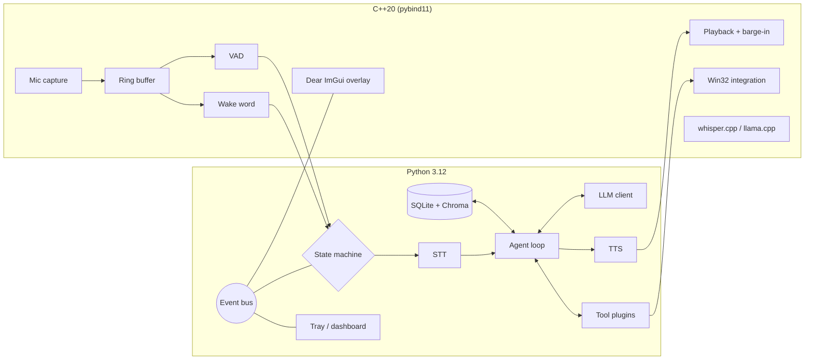

# Jarvis

> A voice-controlled personal AI assistant for the desktop.
> **Python is the conductor, C++ is the muscle.**

[](https://github.com/b1-loop/jarvis-desktop/actions/workflows/ci.yml)


Jarvis listens for a wake word, transcribes what you say, lets an LLM agent
decide which tools to call, and answers out loud while you can still interrupt
it. Everything that has to be fast (audio capture, voice activity detection,
wake word, playback, Win32 hooks, local inference) is C++20 behind pybind11.
Everything that has to be flexible (agent loop, tools, memory, integrations)
is Python 3.12.

<!-- Demo GIF placeholder: docs/media/demo.gif (recorded in step 14) -->


## Status

| Step | Scope | State |
| --- | --- | --- |
| 1 | Plan | done |
| 2 | Scaffold, tooling, CI | done |
| 3 | C++ audio engine | done |
| 4 | C++ Windows integration | done |
| 5 | STT / TTS / LLM cloud providers | done |
| 6 | Agent core, text-only loop | framework done, agent loop pending |
| 7 | Voice pipeline with barge-in | planned |
| 8 | Phase 1 + 2 tools | providers and web/document helpers done, tools pending |
| 9 | Memory | done |
| 10 | Proactive and routines | done |
| 11 | Vision | planned |
| 12 | LOCAL mode (whisper.cpp, llama.cpp, Piper) | C++ wrappers done, Python LOCAL mode pending |
| 13 | Overlay and dashboard | done |
| 14 | Docs, ADRs, benchmark | planned |

## Architecture



State machine: `IDLE → LISTENING → THINKING → SPEAKING → IDLE`, with barge-in
jumping from `SPEAKING` straight back to `LISTENING`.

Two runtime modes:

| Mode | LLM | STT | TTS | Network |
| --- | --- | --- | --- | --- |
| `cloud` (default) | Claude via Anthropic SDK | faster-whisper | edge-tts | required |
| `cloud` + `JARVIS_LLM_PROVIDER=ollama` | Ollama (local HTTP API) | faster-whisper | edge-tts | TTS only |
| `local` | llama.cpp | whisper.cpp | Piper | none |

Full design, threading model and trade-offs: [ARCHITECTURE.md](ARCHITECTURE.md)
and the [ADRs](docs/adr/README.md).

## Setup (Windows 11)

Prerequisites: Python 3.12, [uv](https://docs.astral.sh/uv/), CMake ≥ 3.28,
Ninja, Visual Studio 2022/2026 with the "Desktop development with C++"
workload, LLVM (for clang-format / clang-tidy).

```powershell
git clone --recurse-submodules https://github.com/b1-loop/jarvis-desktop.git
cd jarvis
uv sync --all-extras
uv run python scripts/build_native.py
uv run python scripts/download_models.py
copy .env.example .env   # add ANTHROPIC_API_KEY
uv run jarvis --text-only
```

macOS and Linux: the OS layer is behind a `Platform` interface and not yet
implemented for those systems. Text-only mode runs anywhere.

## Usage

```powershell
uv run jarvis                       # cloud mode, wake word "hey jarvis"
uv run jarvis --mode local          # fully offline
uv run jarvis --no-wakeword         # push-to-talk with the global hotkey only
uv run jarvis --text-only           # type instead of talk, for development
```

## Features

Phase 1 (core): wake word and hotkey, streaming voice answers with barge-in,
text-only mode, persistent memory, computer control, sandboxed shell commands
with spoken confirmation, status overlay and tray icon.

Phase 2 (integrations): email, calendar, web search and article reading,
YouTube summaries, file search and document summaries, screen understanding,
dev mode, Slack/Discord/Teams, Spotify, notes and todo, system monitoring,
smart home.

Phase 3 (wow): proactive notifications, YAML routines, multi-step task
chaining, document production, configurable persona, fully offline mode,
dashboard, latency benchmark.

The feature list is tracked step by step in the Status table above.

## Latency

Measured by `scripts/benchmark_latency.py`; results table lands in step 14.

## Roadmap

Steps 3 through 14 in the Status table, then macOS and Linux `Platform`
backends.

## What was hard

Written as the project progresses.

- **Keeping the audio callback real-time safe while Python consumes the
  data.** The callback only pushes into a lock-free SPSC ring buffer; a
  worker thread runs the models and Python polls. No native thread ever
  takes the GIL. Dropped samples are counted and reported instead of
  silently lost.
- **Barge-in that feels instant.** The playback queue is drained under a
  `try_lock` so the device thread never blocks, and the worker stops playback
  directly when speech starts. Python finds out afterwards through a stop
  counter rather than being on the critical path.
- **Reproducing openWakeWord's streaming maths in C++.** Each 80 ms chunk
  yields 8 mel frames only if three hops of context from the previous chunk
  are prepended; 76 mel frames make one embedding; 16 embeddings make one
  score. Getting the window bookkeeping right was the bulk of the work.
- **Making the native build optional** so text-only development and the
  Linux CI lane need no compiler (ADR-0002).

## Development

See [CONTRIBUTING.md](CONTRIBUTING.md). The one-liner:

```powershell
uv run ruff check . ; uv run ruff format --check . ; uv run mypy ; uv run pytest
```

## License

MIT. See [LICENSE](LICENSE).
