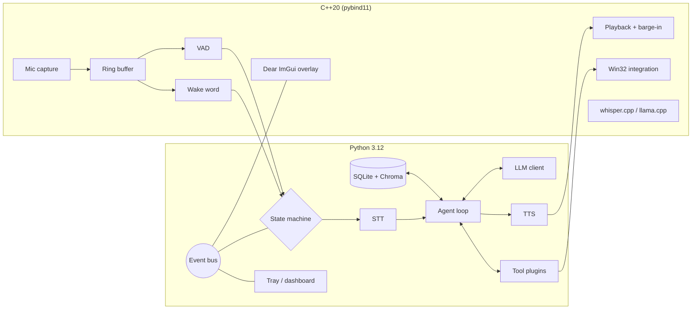

# Jarvis

> A voice-controlled personal AI assistant for the desktop.
> **Python is the conductor, C++ is the muscle.**

[](https://github.com/b1-loop/jarvis-desktop/actions/workflows/ci.yml)


Jarvis listens for a wake word, transcribes what you say, lets an LLM agent
decide which tools to call, and answers out loud while you can still interrupt
it. Everything that has to be fast (audio capture, voice activity detection,
wake word, playback, Win32 hooks, local inference) is C++20 behind pybind11.
Everything that has to be flexible (agent loop, tools, memory, integrations)
is Python 3.12.

<!-- Demo GIF placeholder: docs/media/demo.gif (recorded in step 14) -->


## Status

| Step | Scope | State |
| --- | --- | --- |
| 1 | Plan | done |
| 2 | Scaffold, tooling, CI | done |
| 3 | C++ audio engine | done |
| 4 | C++ Windows integration | done |
| 5 | STT / TTS / LLM cloud providers | done |
| 6 | Agent core, text-only loop | done |
| 7 | Voice pipeline with barge-in | done |
| 8 | Phase 1 + 2 tools | providers and web/document helpers done, tools pending |
| 9 | Memory | done |
| 10 | Proactive and routines | done |
| 11 | Vision | done |
| 12 | LOCAL mode (whisper.cpp, llama.cpp, Piper) | C++ wrappers done, Python LOCAL mode pending |
| 13 | Overlay and dashboard | done |
| 14 | Docs, ADRs, benchmark | planned |

## Architecture



State machine: `IDLE → LISTENING → THINKING → SPEAKING → IDLE`, with barge-in
jumping from `SPEAKING` straight back to `LISTENING`.

Two runtime modes:

| Mode | LLM | STT | TTS | Network |
| --- | --- | --- | --- | --- |
| `cloud` (default) | Ollama `qwen2.5:7b` (local HTTP API, free) | faster-whisper | edge-tts | TTS only |
| `cloud` + `JARVIS_LLM_PROVIDER=anthropic` | Claude via Anthropic SDK | faster-whisper | edge-tts | required |
| `local` (`uv sync --extra local`, `download_models.py --local`) | llama.cpp (in process) | whisper.cpp | Piper | none |

Measured latency, quality, privacy and cost of each mode: [ADR-0013](docs/adr/0013-cloud-vs-local-modes.md).
Small local models get a short, relevant tool list per request instead of all
of them, and never get to claim success for a tool that failed:
[ADR-0020](docs/adr/0020-tool-selection-for-small-models.md).

Full design, threading model and trade-offs: [ARCHITECTURE.md](ARCHITECTURE.md)
and the [ADRs](docs/adr/README.md).

## Setup (Windows 11)

Prerequisites: Python 3.12, [uv](https://docs.astral.sh/uv/), CMake ≥ 3.28,
Ninja, Visual Studio 2022/2026 with the "Desktop development with C++"
workload, LLVM (for clang-format / clang-tidy), and
[Ollama](https://ollama.com/download) for the default, free, local LLM.

```powershell
git clone --recurse-submodules https://github.com/b1-loop/jarvis-desktop.git
cd jarvis
ollama pull qwen2.5:7b   # the default model; Ollama must be running
uv sync --all-extras
uv run python scripts/build_native.py
uv run python scripts/download_models.py
copy .env.example .env   # no key needed for the Ollama default
uv run jarvis --text-only
```

Optional cloud upgrade: Claude answers better and faster on long tool
chains. Set `JARVIS_LLM_PROVIDER=anthropic` and `ANTHROPIC_API_KEY=...` in
`.env`; everything else stays the same.

macOS and Linux: the OS layer is behind a `Platform` interface and not yet
implemented for those systems. Text-only mode runs anywhere.

## Usage

```powershell
uv run jarvis                       # default mode (Ollama LLM), wake word "hey jarvis"
uv run jarvis --mode local          # fully offline
uv run jarvis --no-wakeword         # push-to-talk with the global hotkey only
uv run jarvis --text-only           # type instead of talk, for development
```

### Using Jarvis

- **Wake word.** Say "Hey Jarvis", wait for the short beep, then speak.
  Jarvis listens until you pause, answers aloud and prints the exchange in
  the terminal (`you> ...`, `Jarvis> ...`).
- **Hotkey.** Press `Ctrl+Alt+J` (`JARVIS_HOTKEY`) instead of the wake word.
  With `--no-wakeword`, or when the wake-word models are missing, the hotkey
  is the only trigger and Jarvis says so when it starts.
- **Barge-in.** Just talk over Jarvis: it stops speaking at once and treats
  what you say as the next request. Speech in the first 400 ms of an answer
  is ignored so Jarvis does not interrupt itself (`JARVIS_BARGE_IN_ECHO_GUARD_MS`).
- **Text mode.** `--text-only` types instead of talks and needs no audio
  devices or native build. Voice mode falls back to it, with the reason,
  when the audio build, the models or a microphone are missing.
- **Headphones.** There is no acoustic echo cancellation: with loud
  speakers Jarvis can hear itself and stop mid-sentence. Use headphones or
  turn the volume down (or raise `JARVIS_VAD_MIN_SPEECH_MS`).
- **Leaving.** Say "goodbye", choose Quit in the tray menu, or press Ctrl+C.

### Install as an app

No PowerShell needed after this. From the checkout, once:

```powershell
uv run python scripts/install_shortcuts.py --autostart
```

This creates a **Jarvis** shortcut on the desktop, in the Start menu and in
your Startup folder (`shell:startup`), so Jarvis starts with Windows. Each
one runs `uvw run --project <checkout> jarvis --background`: no console
window, the tray icon is the app. On start you get one notification,
"Jarvis is listening; say 'Hey Jarvis' or press Ctrl+Alt+J" (it also tends
to wake on the Swedish "Hej Jarvis"). Double-click the tray icon or pick
Show dashboard to open the dashboard. Opening a shortcut while Jarvis is
already running brings that one forward instead of starting a second one.
If Ollama is the LLM and is not running, Jarvis starts it, hidden.

- **Choose what to create:** `--no-desktop`, `--no-start-menu`,
  `--autostart` / `--no-autostart` (the options describe the end state, so
  `--no-autostart` removes an autostart shortcut made earlier).
- **Remove it:** `uv run python scripts/install_shortcuts.py --uninstall`
  deletes exactly the shortcuts the script created (recorded in
  `data/desktop-shortcuts.json`).
- **Log:** `data\logs\jarvis.log` in the checkout (rotated at 1 MB, three
  backups). If voice cannot start (native build, models, microphone), the
  notification and the tray tooltip say why and point there; Quit in the
  tray menu exits.

The shortcuts point at the checkout, so run the script again if you move
it. ADR-0021 explains why this is a shortcut to `uvw` rather than a frozen
`.exe`.

## Features

Phase 1 (core): wake word and hotkey, streaming voice answers with barge-in,
text-only mode, persistent memory, computer control, sandboxed shell commands
with spoken confirmation, status overlay and tray icon.

Phase 2 (integrations): email, calendar, web search and article reading,
YouTube summaries, file search and document summaries, screen understanding,
dev mode, Slack/Discord/Teams, Spotify, notes and todo, system monitoring,
smart home.

Phase 3 (wow): proactive notifications, YAML routines, multi-step task
chaining, document production, configurable persona, fully offline mode,
dashboard, latency benchmark.

The feature list is tracked step by step in the Status table above.
Every tool, whether it asks for confirmation and the service it uses is listed in the [tool catalogue](docs/tools.md).

## Latency

Measured by `scripts/benchmark_latency.py`; results table lands in step 14.

## Roadmap

Steps 3 through 14 in the Status table, then macOS and Linux `Platform`
backends.

## What was hard

Written as the project progresses.

- **Keeping the audio callback real-time safe while Python consumes the
  data.** The callback only pushes into a lock-free SPSC ring buffer; a
  worker thread runs the models and Python polls. No native thread ever
  takes the GIL. Dropped samples are counted and reported instead of
  silently lost.
- **Barge-in that feels instant.** The playback queue is drained under a
  `try_lock` so the device thread never blocks, and the worker stops playback
  directly when speech starts. Python finds out afterwards through a stop
  counter rather than being on the critical path.
- **Reproducing openWakeWord's streaming maths in C++.** Each 80 ms chunk
  yields 8 mel frames only if three hops of context from the previous chunk
  are prepended; 76 mel frames make one embedding; 16 embeddings make one
  score. Getting the window bookkeeping right was the bulk of the work.
- **Making the native build optional** so text-only development and the
  Linux CI lane need no compiler (ADR-0002).

## Development

See [CONTRIBUTING.md](CONTRIBUTING.md). The one-liner:

```powershell
uv run ruff check . ; uv run ruff format --check . ; uv run mypy ; uv run pytest
```

## License

MIT. See [LICENSE](LICENSE).
